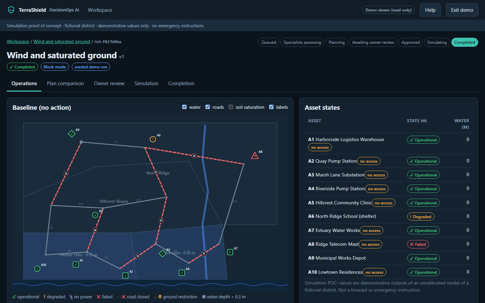
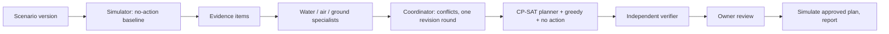

# TerraShield DecisionOps AI

**A simulation proof of concept.** Local-first, multi-agent hazard simulation and constrained response planning with human approval, for a fictional coastal district.

## The problem

Coastal storms rarely arrive as one hazard. Rain, a high tide and wind act together, wet slopes close roads, and a flooded substation can stop pumps that were never under water. Response teams have limited crews, equipment, budget and routes, and the order of actions matters. Tools that look at one hazard at a time, or that suggest actions without checking whether they can actually be carried out, make those trade-offs hard to see.

## What this project explores

TerraShield lets an owner run a scenario, watch water, air and ground specialists assess it, see where their proposals conflict, compare plans that respect hard limits, approve one, and review what happened in the simulation. The point is to explore how structured agents, a deterministic simulator, a constraint solver and an independent verifier can work together while a person keeps the decision.

It is not an operational forecasting tool, it issues no emergency instructions, and it controls nothing real. All values are demonstrative outputs of an uncalibrated model.



## How it works



- A deterministic hourly simulator (runoff, drainage, overtopping, wind fragility, slope susceptibility, power dependencies) produces evidence with stable IDs.
- Specialists cite that evidence and propose actions from an allowlist; outputs are schema- and evidence-validated.
- OR-Tools CP-SAT schedules actions under crews, equipment, budget, wind limits, road access, prerequisites and requirements. Every plan is re-simulated and checked by a verifier that shares no code with the solver.
- PostgreSQL with pgvector stores everything, including local evidence retrieval filtered by workspace and role.

## Modes

| Mode | What runs | Needs |
| --- | --- | --- |
| **Mock** (default) | Seeded rule-based agents through the real workflow and validators | Nothing beyond Docker |
| **Local** | Real Ollama inference for all four roles and real local embeddings | Ollama with `qwen2.5:3b` and `nomic-embed-text` |

## Quick start

```bash
bash scripts/bootstrap.sh        # or ./scripts/bootstrap.ps1 on Windows
```

This creates `.env` with a random database password if it does not exist, builds and starts the stack, and waits until it is ready. Then open <http://127.0.0.1:8080>, create the owner account on first visit, or choose **Explore the demo**. Manual alternative: copy `.env.example` to `.env`, set `POSTGRES_PASSWORD`, run `docker compose up --build -d`.

## What is implemented

- Four seeded scenarios, Mock and Local modes, owner/operator/demo roles enforced server-side, versioned approval, simulation of the approved plan, completion report, backup/restore, CI.
- Measured results, including where the multi-agent team did **not** beat a simpler variant, are in [Governance and validation](docs/GOVERNANCE_AND_VALIDATION.md).
- Not implemented: public hosting, real data, historical replay, learned world models.

## Documentation

- [Project overview](docs/PROJECT_OVERVIEW.md): purpose, scope, roles, workflow, boundaries
- [Architecture](docs/ARCHITECTURE.md): components, contracts, simulation assumptions, planner, state flow, security
- [Demo and operations](docs/DEMO_AND_OPERATIONS.md): installation, modes, seeded journeys, backup/restore, troubleshooting
- [Governance and validation](docs/GOVERNANCE_AND_VALIDATION.md): human-in-the-loop, permissions, provenance, measured results, limitations

No licence has been chosen yet.
