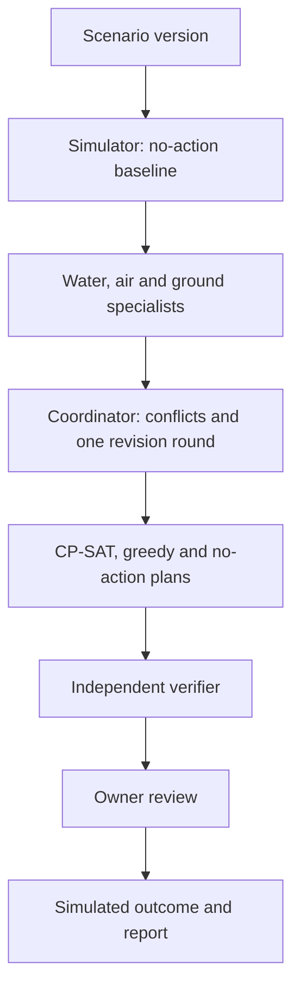

# TerraShield DecisionOps AI

**A simulation proof of concept:** local-first, multi-agent hazard simulation and constrained response planning with human approval, for a fictional coastal district.

## Why

Coastal storms rarely arrive as one hazard. Rain, a high tide and wind act together, saturated slopes close roads, and a flooded substation can stop pumps that were never under water. Crews, equipment, budget and routes are limited, and the order of actions matters. Tools that treat one hazard at a time, or suggest actions without checking that they can be carried out, hide those trade-offs.

## What

TerraShield lets an owner run a scenario, watch water, air and ground specialists assess it, see where their proposals conflict, compare plans that respect hard limits, approve one, and review the simulated outcome. It explores how structured agents, a deterministic simulator, a constraint solver and an independent verifier can work together while a person keeps the decision.

It is not a forecasting tool, issues no emergency instructions and controls nothing real. All values are demonstrative outputs of an uncalibrated model.


## How



- A deterministic hourly simulator (runoff, drainage, overtopping, wind fragility, slope susceptibility, power dependencies) produces evidence with stable IDs.
- Specialists cite that evidence and propose actions from an allowlist; every output is schema- and evidence-validated.
- OR-Tools CP-SAT schedules actions under crew, equipment, budget, wind, road-access and requirement constraints. A verifier that shares no code with the solver re-simulates and checks every plan.
- PostgreSQL with pgvector stores runs, decisions and evidence, with retrieval filtered by workspace and role.


| Mode | What runs | Needs |
| --- | --- | --- |
| **Mock** (default) | Seeded rule-based agents through the real workflow and validators | Docker only |
| **Local** | Real Ollama inference for all four roles and local embeddings | Ollama with `qwen2.5:3b` and `nomic-embed-text` |

## Quick start

The bootstrap scripts create `.env` with a random database password if it is missing, build and start the stack, and wait until it is ready.

Windows (PowerShell):

```powershell
.\scripts\bootstrap.ps1
```

Bash:

```bash
bash scripts/bootstrap.sh
```

Direct Docker startup, after copying `.env.example` to `.env` and setting `POSTGRES_PASSWORD`:

```bash
docker compose up --build -d
```

Then open **<http://127.0.0.1:8088>**, create the owner account on first visit, or choose **Explore the demo**.

### Demo account

A read-only demo account is seeded with the demo data. It sees only the demo workspace and cannot change anything or start runs, and its access is checked by the server.

| Username | Password |
| --- | --- |
| `demo` | `HarborVale-ReadOnly` |

These credentials are public. Do not reuse them anywhere else.

## Scope and results

Implemented: four seeded scenarios, Mock and Local modes, server-side owner/operator/demo roles, versioned approval, simulation of the approved plan, completion report, backup/restore and CI. Not implemented: public hosting, real data, historical replay or learned world models. Measured results, including where the multi-agent team did **not** beat a simpler variant, are in the validation document.

## Documentation

- [Project overview](docs/PROJECT_OVERVIEW.md): purpose, scope, roles, workflow, boundaries
- [Architecture](docs/ARCHITECTURE.md): components, contracts, simulation assumptions, planner, security
- [Demo and operations](docs/DEMO_AND_OPERATIONS.md): installation, modes, seeded journeys, backup/restore, troubleshooting
- [Governance and validation](docs/GOVERNANCE_AND_VALIDATION.md): human oversight, permissions, provenance, measured results, limitations
