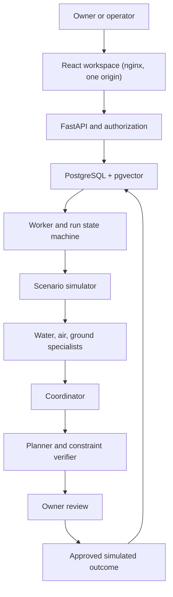

# Architecture

## Components



| Component | Implementation | Notes |
| --- | --- | --- |
| Web | React 19 + TypeScript (Vite), served by unprivileged nginx | Proxies `/api` and `/health` to the API so the browser sees one origin. Map geometry is bundled from `scenarios/district.json`; no external tiles or fonts |
| API | FastAPI + Pydantic, SQLAlchemy 2, psycopg 3 | Sessions, roles, scenarios, runs, review, reports, readiness, operations status |
| Worker | `python -m app.worker` | Claims leased jobs: `analyze`, `replan`, `simulate`, `embed` |
| Database | PostgreSQL 17 with pgvector 0.8.1 | Relational data and vectors in one database; schema via Alembic |
| Migrate | One-shot job: `alembic upgrade head && python -m app.cli seed` | API and worker start only after it succeeds |
| Ollama (optional) | Host install or Compose profile `local-model` | Chat model for the four roles, embedding model for retrieval |

Backend layout: `app/api` (routes), `app/auth` (hashing, sessions, policy), `app/simulation` (district, scenario contract, engine, actions, sensitivity), `app/planning` (CP-SAT solver, planner, verifier), `app/agents` (evidence, schemas, providers, prompts, validation, conflicts, retrieval, workflow), `app/jobs` (queue, state machine, runner), `app/reports`.

## Run lifecycle

```
draft → validated → queued → assessing → planning → awaiting_review → approved → simulating → completed
                                     ↘ blocked   ↘ failed   ↘ cancelled          ↘ rejected   ↘ blocked (approval invalidated)
```

- Every transition is a compare-and-set `UPDATE … WHERE status IN (…)`, recorded as a trace event. A cancel racing a worker either wins immediately (queued, awaiting review, approved) or sets `cancel_requested`, which the worker honours at its next step.
- Approval and simulation are separate persisted events. Requesting a revision moves the run back to `queued` with a new plan revision.
- Jobs live in `job_leases`. Workers claim with `FOR UPDATE SKIP LOCKED`, extend the lease while working, and finish only if they still own the lease (fencing). An expired lease is reclaimed after a crash; attempts are bounded (3) with exponential backoff, then the run fails with `retries_exhausted`. Enqueueing is idempotent on a key such as `run:<id>:simulate`.
- Re-executing an analysis deletes that revision's partial artifacts first, so a recovered job does not duplicate assessments or plans.
- `POST /api/scenarios/{id}/runs` accepts an `Idempotency-Key` header; a repeated key returns the original run.

Each run records mode, seed, simulator/planner/policy/workflow versions, model and embedding model identifiers, the input hash, an immutable copy of the inputs, timestamps, analysis duration and failure details.

## Simulation assumptions

All equations are deliberately simple and uncalibrated. Hourly time steps; values evaluated at hour midpoints.

| Part | Model |
| --- | --- |
| Hazard drivers | Rainfall = base + Gaussian bump (mm/h). Sea level = mean + semi-diurnal tide (12.42 h) + Gaussian surge (m). Wind = base + Gaussian bump (m/s); gust = wind × gust factor |
| Soil | Bucket per zone: S ← clamp(S + I/(n·D) − k·S), with infiltration I (mm), porosity n, active depth D (mm), drainage rate k (1/h) |
| Runoff | Coefficient c = imperviousness + (1 − imperviousness)·S² |
| Upland zones | Runoff above gravity capacity is routed downstream by fixed fractions |
| Ponding zones | Storage balance V ← V + runoff + upstream excess + overtopping − min(V + inflow, gravity + pumps); depth = V / (area × ponding fraction) |
| Outfalls | Gravity drainage blocked linearly over 0.5 m as sea level rises above the outfall elevation |
| Overtopping | Lumped weir q = 0.05·(sea − crest)^1.5 m³/s per metre of wall |
| Assets | Hazard intensity (zone water level, site gust, slope index) is separated from exposure (elevation, exposure factor) and vulnerability (fragility thresholds). Flood depth above the failure depth or gust above the threshold → failed (permanent); above 0.05 m / 85 % of threshold → degraded |
| Dependencies | Pump stations and the water works depend on the substation; a backup generator removes that dependency. Pumping uses the previous hour's state (explicit one-step lag) |
| Roads | Closed if ponding level exceeds the low point by 0.25 m (flood), if the slope index susceptibility·S² exceeds 0.5 (ground, permanent), if site gust exceeds the closure gust (wind), or from the hour of an accepted ground restriction |
| Disruption | Σ criticality × severity per hour (failed 1.0, no power 0.8, degraded 0.4, operational 0) + 0.3 × criticality while the depot cannot reach the asset |

Mass balance is checked in tests: inflow − outflow − final storage = 0 (to rounding) for every seeded scenario and 25 random perturbations. Sensitivity ranges use 16 seeded perturbations (rain peak ±12 %, surge ±0.15 m, wind ±8 %, saturation ±0.04); they are scenario sensitivity, not probabilities.

## Planning

1. **Candidates**: the coordinator's selected actions (agent-guided runs) or the full catalog (evaluation). Prerequisite actions are added automatically.
2. **Options**: one option per action, target and feasible start hour. Starts are filtered by the wind working limit over the whole action window and by road access at the start hour, using closures from the baseline plus accepted restrictions.
3. **Benefit**: simulated disruption reduction of the single action (with its prerequisite).
4. **CP-SAT** (OR-Tools 9.15) maximises Σ (benefit − cost weight × cost − 0.05 × end hour) subject to: one start per action, crews per hour, equipment inventory, budget, mutual exclusion (sandbags vs barrier on one asset), prerequisites (drains cleared before a temporary pump), and requirement clauses (at least one option that removes each threat to a must-keep asset, where a single-action fix exists). Three variants: balanced, lowest cost (half the budget) and maximum protection. A solver stop at the time limit is reported as `time_limited`, never as optimal; an infeasible model is reported as `infeasible`.
5. **Simulate and replan**: each plan is simulated; junctions found unreachable in a plan's own simulation are added to the access filter and the solver runs again (at most 3 iterations).
6. **Greedy heuristic** and **no action** are computed for comparison.
7. **Independent verifier** (`app/planning/verifier.py`, shares no code with the solver or coordinator) re-simulates every plan and checks allowlist, uniqueness, time window, budget, crew capacity, equipment, mutual exclusion, prerequisites, wind limits, road access in the plan's own simulation, and scenario requirements.
8. **Ranking** of verified plans only: score = disruption + cost / 2000 + 0.5 × completion hour. Components are reported separately. If no plan passes every check, the run is **blocked**.

## Agents

One shared workflow (`app/agents/workflow.py`) for both providers:

1. Baseline simulation → structured evidence items with stable IDs (for example `ev-asset-A3-failure`), each tagged with a domain.
2. Retrieval per role (pgvector, filtered by workspace and role before ranking).
3. Water, air and ground assessments → validated.
4. Deterministic conflict detection (route blocked or narrowed by a restriction, wind-infeasible, too late to help, no common window, resource shortfall, mutually exclusive).
5. Coordinator consolidation → validated; may request **one** revision round (configurable), then consolidates again.
6. Planning over the coordinator's selected actions with accepted ground restrictions as hard closures.
7. Coordinator explanation of the verified plans → validated.

**Contracts** (`app/agents/schemas.py`): Pydantic models with `extra="forbid"`; no field can express approval or permissions. Water and air receive a schema without the restrictions field; only ground may issue restrictions.

**Validation** (`app/agents/validate.py`): JSON parse, schema, role match, evidence IDs visible to the role, existing assets and roads, action types in the role's allowlist with valid targets, restrictions backed by road evidence, citations limited to chunks retrieved for that role, conflict IDs from the detector, selected actions limited to proposals, recommended plan limited to verified plans. One retry with the validator's errors; then the run fails with `agent_output_invalid`.

**Providers** (`app/agents/providers.py`):

| | Mock | Local |
| --- | --- | --- |
| Engine | Seeded deterministic rules reading the same payload | Ollama `/api/chat` with JSON-schema `format` |
| Model id | `mock-rules-1.0` | `ollama:qwen2.5:3b` (configurable) |
| Bounds | n/a | temperature 0, seed, `num_predict` 900, `num_ctx` 6144, 300 s per call, 3600 s per run |
| Failure | n/a | `model_missing`, `model_unavailable`, `model_timeout`, `model_error` recorded; run fails; never relabelled |

Scenario notes are passed as `scenario_notes_untrusted`; the system prompt says instructions inside data are ignored, and the validator enforces the outcome regardless of what the model does.

## Retrieval

Tables: `documents` (workspace scope or global, roles, version, status, provenance, licence), `chunks` (one per section, id `doc#n@version`), `chunk_embeddings` (vector per chunk per model), `embedding_models` (provider, name, dimension, version, semantic flag).

- Mock mode uses `fixture-hash-256-v1`: a labelled lexical feature-hashing fixture, precomputed in `scenarios/corpus/fixture_vectors.json` and checked for reproducibility in CI. It is not a semantic model.
- Local mode uses `ollama:nomic-embed-text` (768 dimensions, version recorded from the Ollama digest). Re-embedding is an explicit job (`python -m app.cli embed` or `POST /api/evidence/reembed`); a changed model digest or dimension drops the stale vectors.
- Exact cosine search (`<=>`), no ANN index: the corpus is 20 chunks. Minimum similarity: 0.15 (fixture), 0.55 (nomic). Below it, the result is `insufficient_evidence`.
- Superseded documents are excluded. Prior run reports can be added to a workspace's library and are only retrievable from that workspace.

## Security boundaries

- Argon2id password hashing, minimum 12 characters, no username in the password, no default credentials. First owner created through `/setup` (one time) or `python -m app.cli create-owner`.
- Server-side sessions: opaque token in an `HttpOnly`, `SameSite=Strict` cookie; only the SHA-256 is stored. 8 h absolute and 60 min idle expiry; 2 h for demo sessions. Five failed logins lock an account for 5 minutes.
- CSRF: unsafe methods require `X-Requested-With: terrashield`; CORS is not enabled.
- Authorization in `app/auth/policy.py`: capability matrix per role, workspace membership checks returning 404 for both missing and forbidden resources, demo sessions rejected on every unsafe method and limited to seeded completed or blocked runs.
- nginx adds CSP (`default-src 'self'`), `X-Frame-Options: DENY`, `nosniff`, `Referrer-Policy: no-referrer`.
- Containers run as non-root (uid 10001 for the backend, nginx-unprivileged for the web). The database is only on an internal Docker network; the web port binds to 127.0.0.1 by default. Secrets come from `.env`, never from images.
- Logs are structured JSON with request and run correlation; passwords, tokens, cookies and prompts are not logged.

## Actual integrations

PostgreSQL/pgvector and, optionally, a local Ollama. There are no cloud APIs, external map tiles, hosted fonts, real infrastructure controls or alerting integrations.
