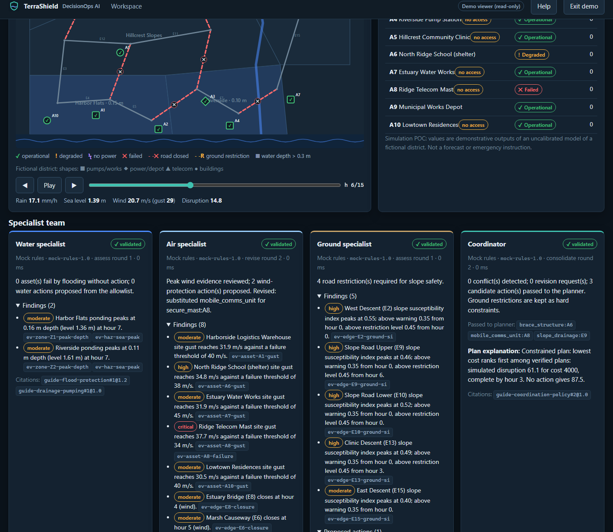
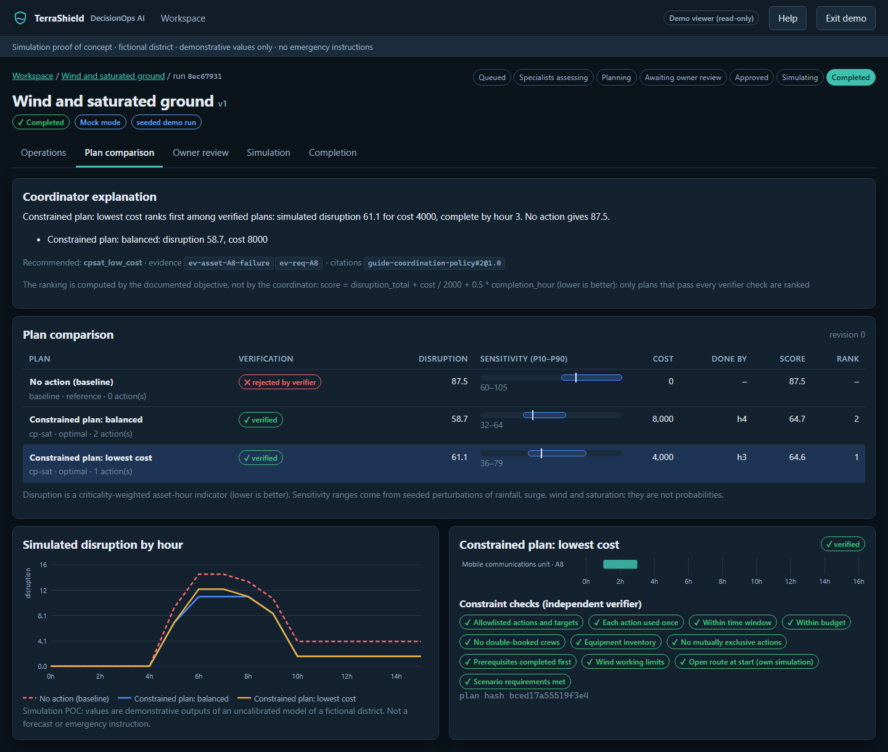
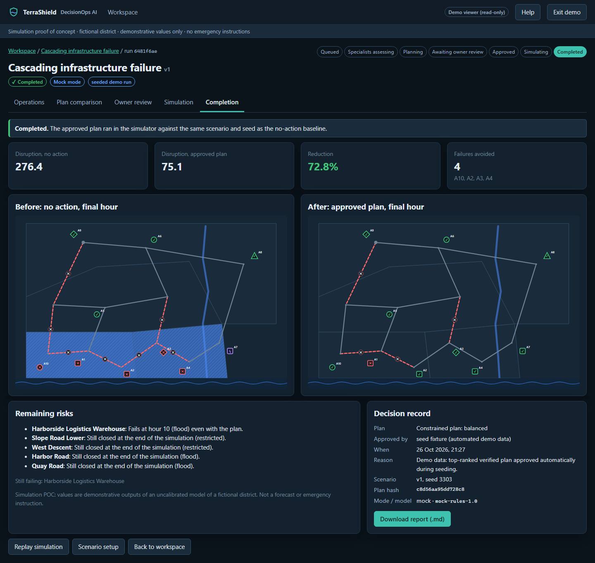

# Project overview

TerraShield DecisionOps AI is a local-first **simulation proof of concept**. It shows how an owner can evaluate a hazard scenario for a fictional coastal district, watch software specialists collaborate, compare constrained response plans, approve one, and review the simulated outcome.

It answers four questions for a scenario:

1. Which assets might be affected?
2. How can failures propagate (for example, lost power stopping pumps)?
3. Which proposed actions stay feasible under crew, equipment, budget, wind and road-access limits?
4. What evidence supports the recommendation?

## Scope

- One fictional district, **Harbor Vale**: four drainage zones, twelve road junctions, fifteen road segments, ten assets.
- Three environmental specialists (water, air, ground) and one coordinator, all software roles.
- Four seeded scenarios with fixed seeds.
- Two model modes: **Mock** (default, no model downloads) and **Local** (real Ollama inference).

"Ground" means soil saturation and a simplified slope-susceptibility index. It does not mean earthquake prediction. Storm surge and tsunami are different mechanisms; tsunami, earthquakes, tornado physics, ozone chemistry, offshore drilling causality and operational emergency alerts are out of scope.

## People and agents

| Identity | What it can do |
| --- | --- |
| Owner | Manage local users and workspaces, create and edit scenarios, run analyses, approve, reject or request revision, run the approved simulation, export reports |
| Operator | Work in assigned workspaces: edit scenarios, start runs, cancel runs, export reports. Cannot approve |
| Demo viewer | Read the seeded completed runs in the demo workspace, replay them and inspect evidence. Cannot change anything or invoke models |
| Water specialist | Runoff, drainage capacity, coastal flooding exposure, water-management actions |
| Air specialist | Wind exposure, wind fragility assumptions, wind working limits |
| Ground specialist | Soil saturation, slope susceptibility, ground-related road restrictions |
| Coordinator | Consolidates assessments, resolves detected conflicts, requests bounded revisions, explains verified plans |

Agents are software roles, not user accounts. The coordinator cannot approve plans, change permissions, override hard constraints, or execute real actions. These limits are enforced by the backend policy and an independent verifier, not by the model.

## Workflow

1. **Workspace**: pick a scenario card; see recent runs, the mode and model readiness.
2. **Scenario setup**: inspect or edit parameters (units and ranges shown). Saving creates a new immutable version.
3. **Run**: the simulator computes the no-action baseline; specialists assess it; the coordinator detects conflicts and may ask for one revision round; the planner builds candidate plans; the verifier checks every plan.
4. **Plan comparison**: no action, a greedy heuristic and constrained CP-SAT plans, with constraint checks, disruption, cost, completion time and sensitivity ranges.
5. **Owner review**: approve a verified plan, reject, or request revision. Approval binds one scenario version and one plan version.
6. **Simulation**: the approved plan runs hour by hour in the simulator against the same scenario and seed as the baseline.
7. **Completion**: before/after maps, outcomes, remaining risks, the decision record and a downloadable report.

Runs can also end **blocked** (no plan satisfies the hard constraints and requirements), **failed** (for example a model timeout or invalid model output), **rejected** or **cancelled**. Each state is shown as such; nothing is relabelled.

## Practical scenario

In *Conflict and insufficient resources*, the Quay pump station must stay operational. The ground specialist restricts saturated slope roads as a precaution, which narrows the water specialist's only route to the harbour. With one crew, no barrier sets and a small budget, no plan keeps the pump station dry and powered, so the run ends **blocked** with the unmet requirement explained. Raising crews, barrier sets and budget in scenario setup produces a verified plan.

## Boundaries

- All values are demonstrative outputs of a simplified, uncalibrated model. They are not forecasts, probabilities or engineering results.
- No emergency instructions, real infrastructure control, public alerts or external services.
- Docker readiness is a local deployment package, not public hosting.

<!-- help:start -->
## Using TerraShield

TerraShield is a **simulation proof of concept** for a fictional district. Values are demonstrative and uncalibrated; nothing here is a forecast or an emergency instruction.

### Scenarios

A scenario sets rainfall, coastal water level (tide plus surge), wind, initial soil saturation, available resources and any hard requirements, such as an asset that must stay operational. Every edit creates a new immutable version. Runs keep the exact inputs they started with.

### Units

- Rainfall in **mm/h**, water level and depth in **m** above datum, wind in **m/s** (sustained; gust = sustained x gust factor).
- Soil saturation is the **fraction of pore space** filled (0 to 1).
- Disruption is a **criticality-weighted asset-hour indicator**: failed counts 1.0, no power 0.8, degraded 0.4, plus 0.3 when the depot cannot reach the asset.
- Costs are in generic currency units.

### Agent roles

- **Water** assesses flooding, drainage and pumping; proposes protection, pumping and generators.
- **Air** assesses wind exposure and working limits; proposes bracing, mast securing or substitutes.
- **Ground** assesses saturation and slope susceptibility; restricts unsafe roads.
- **Coordinator** resolves detected conflicts, may ask for one revision round, and explains verified plans.

Agents interpret computed evidence and cite it by ID. They cannot invent measurements, approve plans or override restrictions.

### Approval

Only the owner can approve, and only plans that passed every verifier check. An approval binds the scenario version and the plan hash. Editing the scenario afterwards invalidates the approval and blocks the run. Simulation of the approved plan is a separate step.

### Modes

- **Mock**: seeded, rule-based agent outputs through the same workflow and validators. No model inference.
- **Local**: real inference with a local Ollama model. If the model is missing, slow or returns invalid output, the run fails and says so; it is never relabelled as Mock.

### Limitations

The simulator uses simple documented equations (runoff coefficients, a storage balance, a lumped overtopping weir, fragility thresholds and a slope index). Sensitivity ranges come from seeded perturbations and are not probabilities. Retrieval similarity shows relevance, not truth.
<!-- help:end -->
